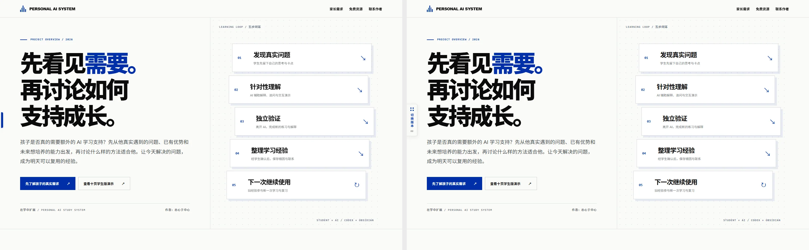
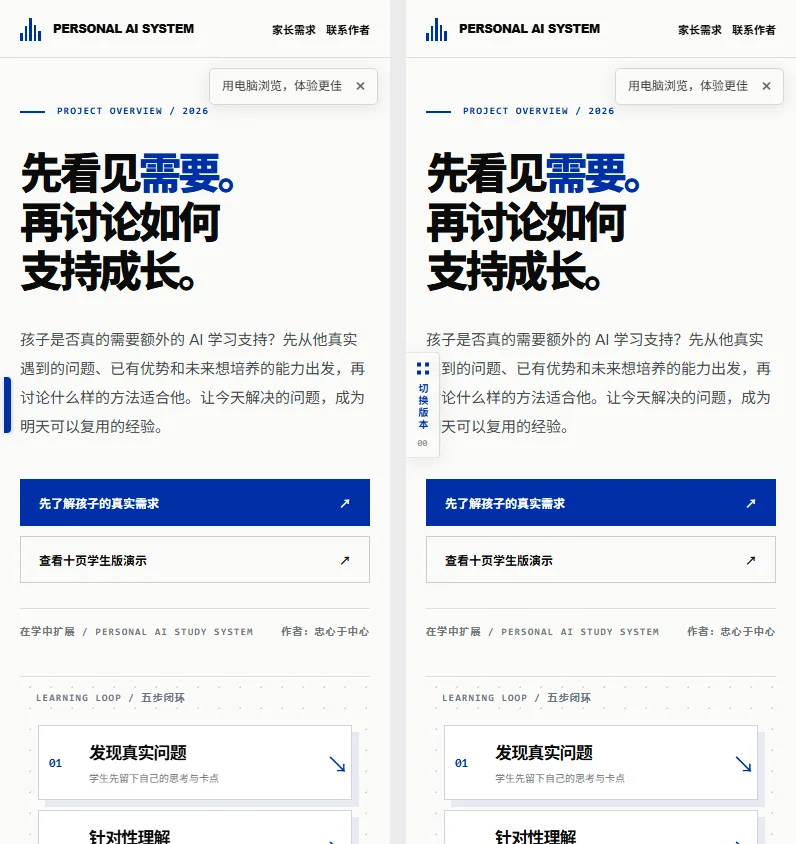
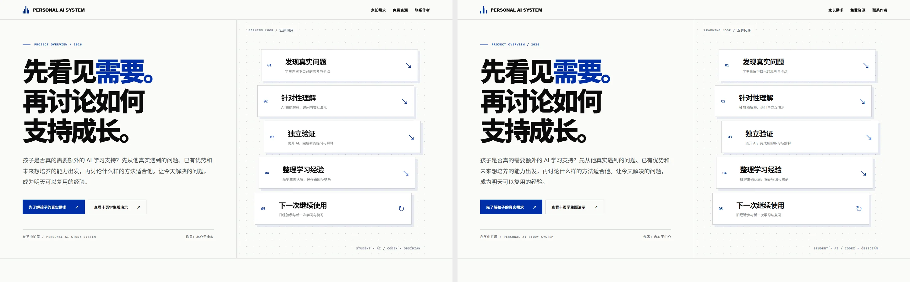
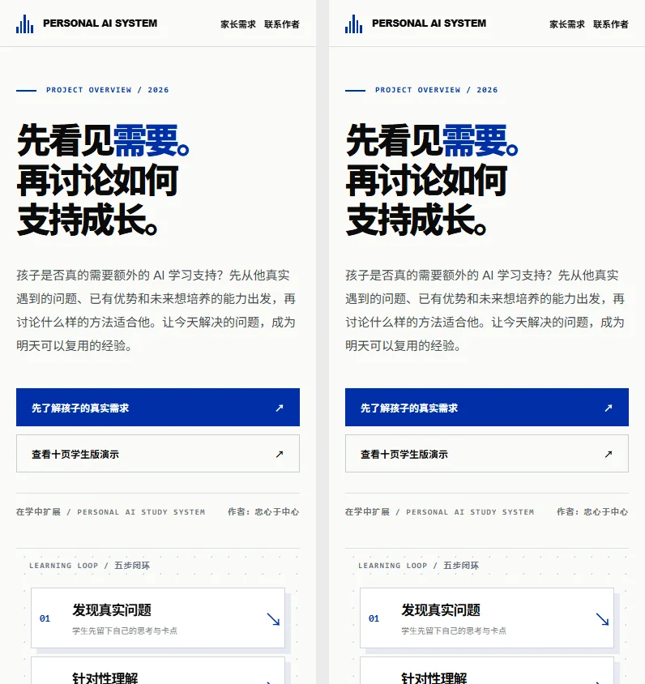
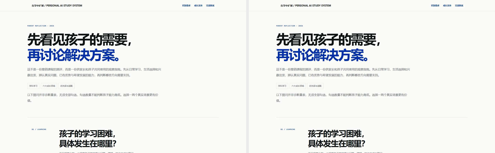
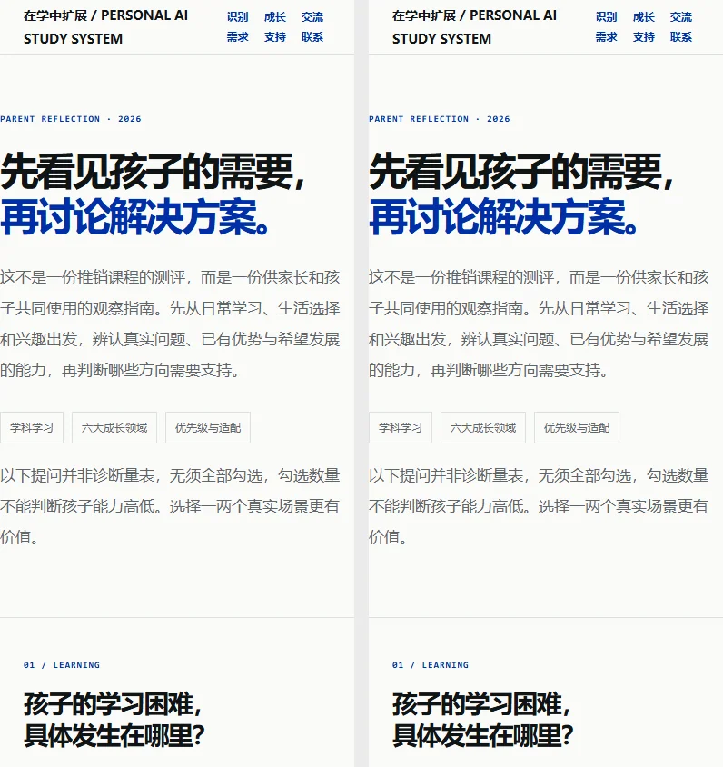
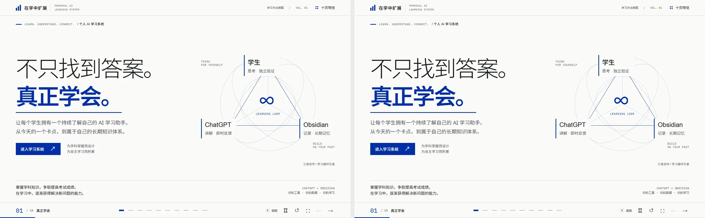
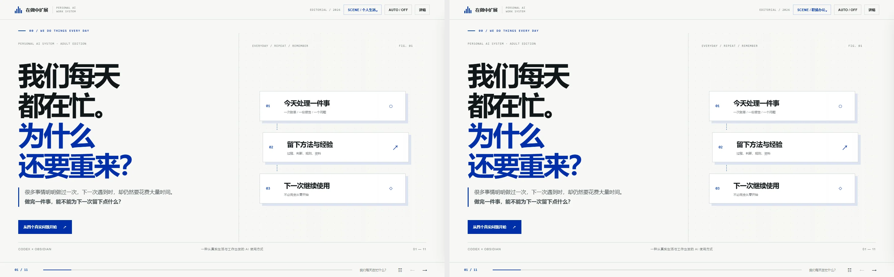
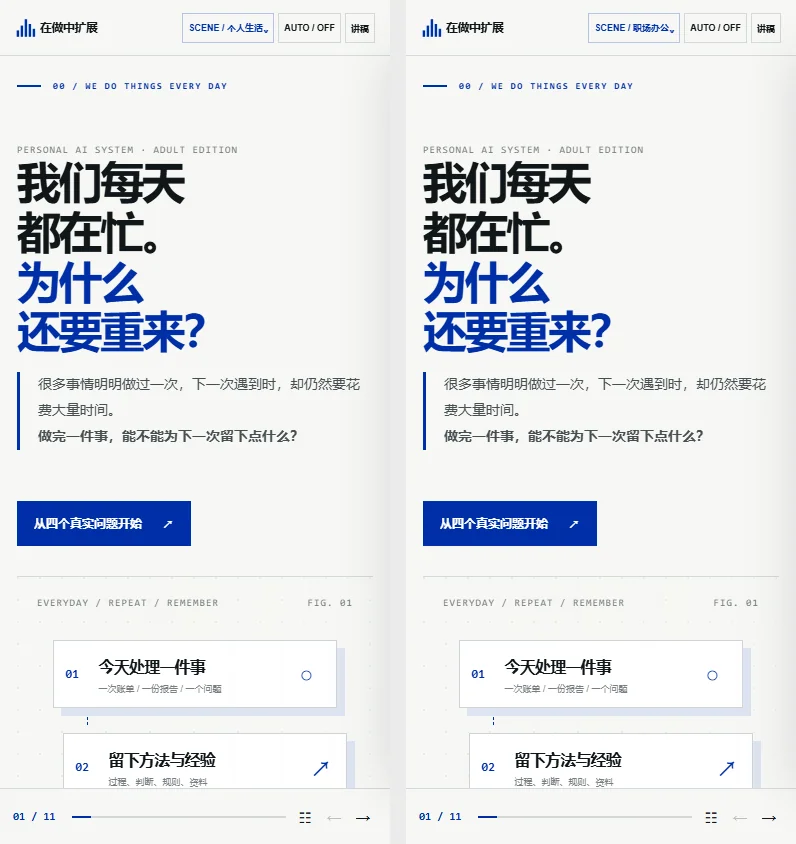

# 新旧版截图对照：左侧旧版，右侧 React 版

Chrome 同视口，prefers-reduced-motion: reduce；2026-10-28。从现有旧站与独立 React 预览站分别截取相同页面的首屏。截图不是所有交互状态的全面视觉验证。

## home
**1440 px**

**390 px**

## about
**1440 px**

**390 px**

## needs
**1440 px**

**390 px**

## study
**1440 px**

**390 px**

## adult
**1440 px**

**390 px**

